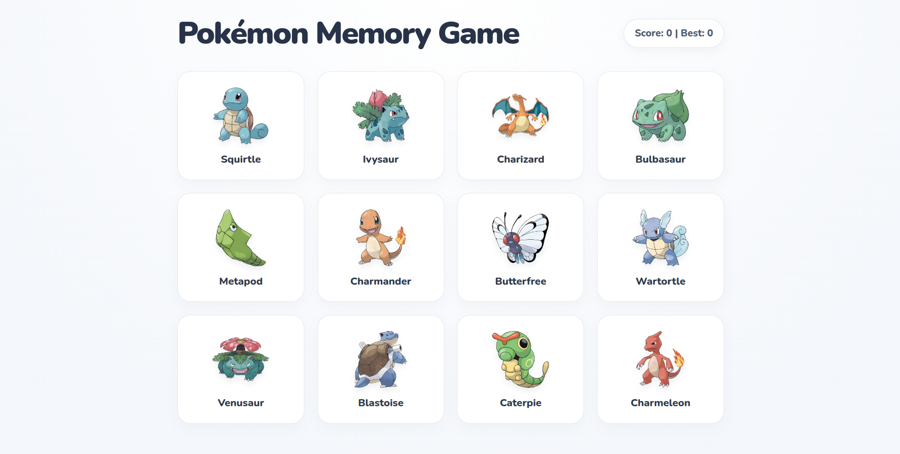

# Pokémon Memory Game

A small memory game built with React and Vite. Click a Pokémon card to earn a point, then remember which cards you have already chosen as the cards shuffle after every pick.



## How to play

- Choose a Pokémon you have not clicked during the current round.
- Each card click reshuffles the board.
- Clicking a Pokémon a second time resets your current score to zero.
- Your best score is tracked for the current session.
- Selecting all 12 Pokémon completes the round and starts a new one.

## Getting started

### Requirements

- Node.js (with npm)

### Install and run

```bash
npm install
npm run dev
```

Open the local URL printed by Vite in your browser.

## Available scripts

| Command | Description |
| --- | --- |
| `npm run dev` | Start the Vite development server. |
| `npm run build` | Create a production build in `dist/`. |
| `npm run preview` | Preview the production build locally. |
| `npm run lint` | Run ESLint on the project. |

## Data and artwork

The game fetches the first 12 Pokémon from the [PokéAPI](https://pokeapi.co/) when it loads. Pokémon artwork is served from the [PokeAPI sprites repository](https://github.com/PokeAPI/sprites). An internet connection is needed to load the cards.

## Built with

- React
- Vite
- PokéAPI
